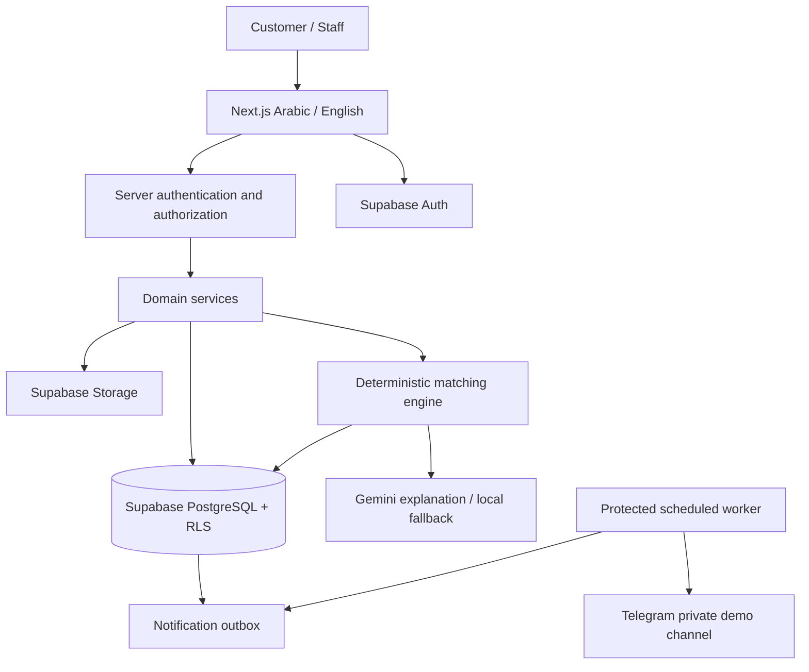

# المعمارية العامة

## الفكرة ببساطة

تطبيق Next.js واحد يخدم المتجر ولوحة الإدارة وواجهات الخادم. Supabase هو مصدر الحقيقة للمنتجات والمخزون والحسابات والطلبات. Gemini كاتب شرح، وTelegram قناة إشعار. عند تعطل أي منهما تبقى العمليات الأساسية قابلة للاستخدام.

## الوحدات وحدود المسؤولية

| الوحدة | مسؤوليتها | لا تقوم به |
|---|---|---|
| catalog | قراءة المنتجات المنشورة، البحث والفلاتر والصور | كشف SKU stock الداخلي أو تعديل الأسعار من العميل |
| accounts | الجلسة والملف الشخصي والمفضلة والسلة | تعديل أدوار الموظفين |
| checkout | التحقق من العرض وإنشاء طلب ذري | الثقة بالمجموع المرسل من المتصفح |
| orders | دورة الحالات والسجل وتحصيل COD | تعديل تاريخ أسعار الطلب بعد إنشائه |
| inventory | كميات SKU وحركات المخزون | قراءة عناوين المشترين لمسؤول المخزن |
| advisor | الاختبار والـprofile والترتيب والشرح | الطلب من النموذج اختيار منتجات حرة |
| admin | إدارة التشغيل حسب الدور | تجاوز تحقق الخادم لأن الرابط مخفي |
| notifications | تسجيل وتسليم محاولات Telegram | التراجع عن طلب صحيح لأن الإشعار فشل |

## القرارات المعمارية

- تطبيق واحد، متجر واحد لكل نشر، قاعدة واحدة. إعادة استخدام المشروع للوكالة عبر إعدادات الهوية ونسخة نشر مستقلة لكل عميل.
- بيانات المعاملات في PostgreSQL، الصور في Storage. لا نخزّن قاعدة بيانات كاملة في localStorage.
- عرض المتجر العام قابل للتخزين المؤقت القصير؛ الحساب والسلة والطلبات والإدارة ونتائج الاختبار الخاصة بلا cache مشترك.
- يُبطل cache المنتجات عند تعديل المنتج. السعر والمخزون يعاد فحصهما دائمًا عند إتمام الطلب مهما ظهر في صفحة قديمة.
- الوحدات الخارجية وراء adapters صغيرة: `gemini.server.ts` و`telegram.server.ts`. الاختبارات تستبدلها بمزود وهمي، لكن وضع العرض النهائي يستخدم الخدمات الحقيقية.
- أدوار الإدارة ثلاثة فقط. العميل حساب Auth عادي بلا staff_roles. التصفح والاختبار وسلة مؤقتة متاحون للزائر؛ إتمام الطلب والمفضلة الدائمة يتطلبان تسجيل الدخول كقرار تبسيط للديمو.

## التدفقات الحرجة

### الطلب

العميل يرسل variant IDs والكميات والعنوان ومعرف منطقة التوصيل والكوبون ومفتاح idempotency. الخادم يثبت الهوية ويطلب معاملة قاعدة بيانات: قفل المخزون والكوبون، إعادة التسعير، التحقق، إنشاء الطلب والبنود، حجز الكمية بخصمها من `stock_available`، تسجيل استخدام الكوبون وحركة المخزون وoutbox. بعد commit يعود النجاح للمستخدم. العامل يعالج الإشعار لاحقًا حتى لو أُغلق المتصفح.

### الاستشارة

الخادم يقرأ نسخة الاختبار ويراجع option IDs ثم يحسب profile. يستبعد المنتجات المؤرشفة أو غير المتاحة أو المستثناة، ويحسب score لثلاثة منتجات مختلفة. تُحفظ النتيجة قبل صياغة الشرح؛ Gemini يستلم خصائص غير شخصية فقط. جميع بطاقات المنتجات مبنية من بيانات المتجر. مهلة Gemini أو مخرجاته غير الصالحة تنتج شرحًا محليًا باللغتين.

### الإدارة

تحقق جلسة + دور حالي في الخادم + سياسة RLS/صلاحيات RPC داخل قاعدة البيانات. سجّل من غيّر السعر أو المخزون أو الحالة أو الدور. حذف منتج استُخدم في طلب يعني أرشفته؛ لا يمحو السجل التجاري.

## الاتساق والأعطال

| المشكلة | السلوك المطلوب |
|---|---|
| عميلان يشتريان آخر وحدة | طلب واحد ينجح والثاني يحصل على STOCK_CHANGED بلا كتابة جزئية |
| ضغط زر الطلب مرتين أو انقطاع الرد | نفس المفتاح ونفس payload يعيدان الطلب نفسه |
| سعر تغير منذ العرض | PRICE_CHANGED ثم عرض تسعير جديد وموافقة المستخدم قبل إنشاء الطلب |
| Gemini غير متاح | نتائج حقيقية مع شرح محلي؛ لا يغيّر score |
| Telegram غير متاح | الطلب محفوظ، إشعار pending/failed قابل لإعادة المحاولة |
| نتيجة قديمة لعطر نفد | لا زر شراء فعال له؛ إعادة مطابقة عند طلب العميل |
| Supabase غير متاح | خطأ واضح قابل للمحاولة، لا نجاح وهمي ولا طلب في ذاكرة المتصفح فقط |

## ما لا يحتاجه هذا المشروع

لا محرك بحث خارجي، لا Redis مبدئيًا، لا embeddings، لا منفذ دفع، لا ERP أو نظام شحن مستقل. قاعدة البيانات تكفي للبحث البسيط وoutbox وتحديد المعدل. لا تستخدم Realtime ما دام تحديث الصفحة أو إعادة جلب البيانات يفي بالغرض.

## عقود التنفيذ

التفاصيل الملزمة في [DATABASE](docs/DATABASE.md)، [BACKEND](docs/BACKEND.md)، [API_CONTRACTS](docs/API_CONTRACTS.md)، [RECOMMENDATION](docs/RECOMMENDATION.md). هيكل الملفات في [FILE_MAP](docs/FILE_MAP.md)، وقبول الديمو في [TESTING](docs/TESTING.md).
